<div align="center">

# 智生活管理費暨財務系統

**把智生活匯出的管理費報表，整理成財委每個月要交的帳。**

逐月銷帳 · 在途存款 · 收支報表 · 欠費催繳 · 零用金

  

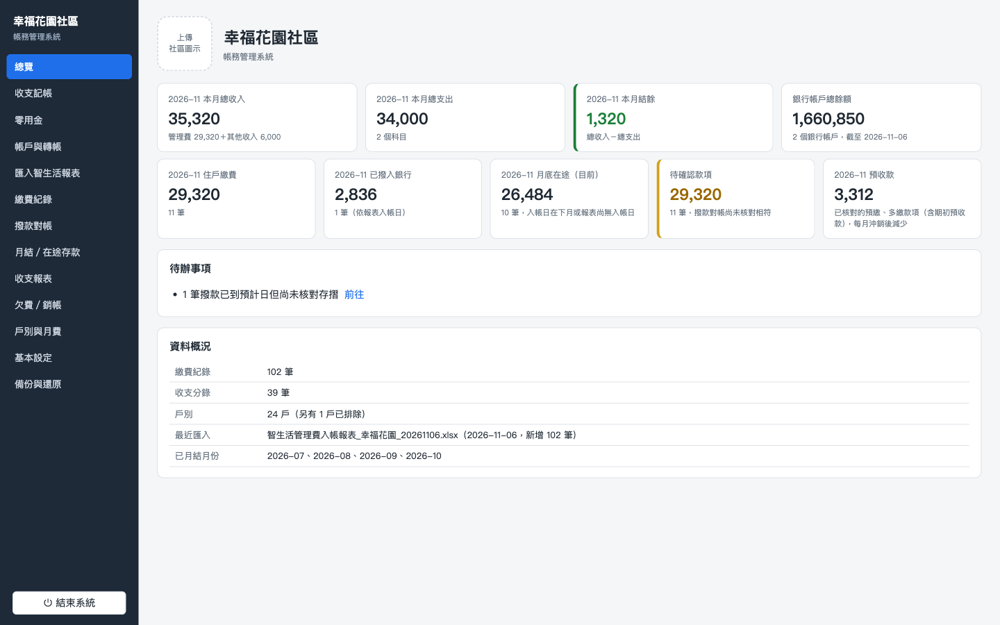

</div>

> 畫面中的社區、戶別、人名與金額都是虛構的示範資料。

## 這是什麼

社區管委會用「智生活」收管理費，但智生活只給報表，財委每個月還是要自己算：

- 哪幾戶繳了、銷到哪個月？誰還欠幾期？
- 住戶繳了錢，什麼時候才撥進銀行？月底有多少在途存款？
- 收支報表、月報、管理費銷帳明細要怎麼印給委員簽名？

這套系統讀進智生活的「管理費匯入範本」和「管理費入帳報表」，自動完成上面這些事。

- **免安裝、免網路**：解壓縮後雙擊 `社區帳務管理.exe` 就會開啟瀏覽器使用。
- **資料只存在這台電腦**：所有紀錄都在 exe 旁邊的 `data` 資料夾，每天自動備份，換電腦整個資料夾帶走即可。
- **跟著智生活走**：戶別一律使用智生活的「戶別代碼」，每月匯入報表就好，不用重打資料。

## 主要功能

### 1. 匯入每月應繳報表，戶別與所有權人一起比對

從智生活匯出「管理費匯入範本」直接匯入。檔案內的戶別預設全部匯入，不需要管理的戶別（例如管理室）勾選「排除」即可。
每次匯入都會比對所有權人：換人的戶別要選擇「從帳單月份起變更」，**之前月份的紀錄不會被改掉**。

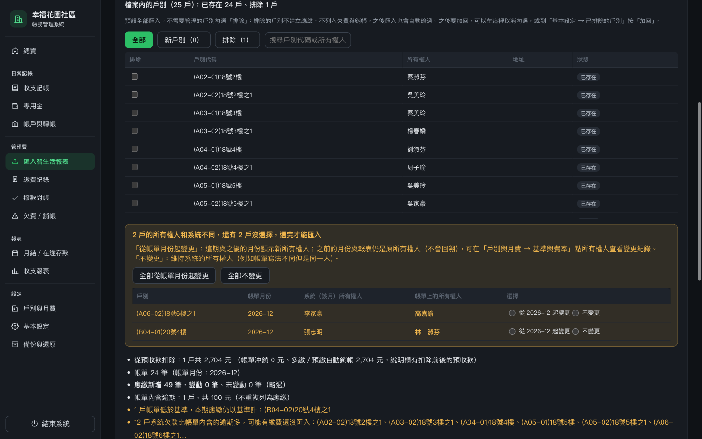

### 2. 帳單項目對應基準，不同的逐戶確認

智生活會把逾期金額加在當期帳單上。系統用你設定的「基準與費率」（坪數費、汽車位清潔費、機車位清潔費……）拆出本期應繳與帳單內含的逾期，**逾期不會被重複計算**。
帳單金額和基準不同的會逐戶列出，選「更新基準」或「不更新」後才能匯入。
帳單上的沖銷項目（年繳沖銷、預繳沖銷……名稱不拘）對應到「沖銷」後，會用沖銷金額從這戶的預收款扣除；啟用前就已年繳、半年繳的戶別，可以在「期初預收款」輸入還剩多少。

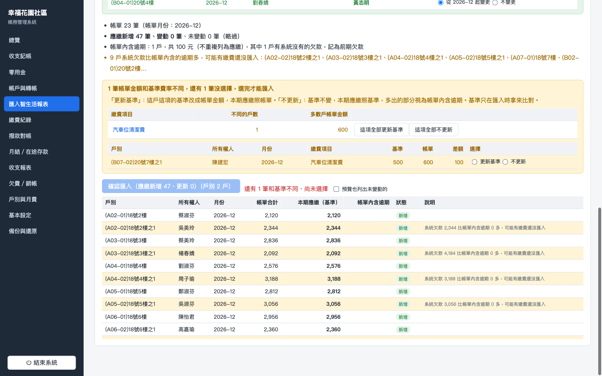

### 3. 基準與費率：坪數計費、加收、年繳季繳

費率方案可以依坪數計算或固定金額，每戶另外加收車位清潔費並設定數量，也可以設定年繳、季繳與起始月份。
調整費率只影響之後匯入的月份，已匯入的月份保留當時的基準。


### 4. 所有權人變更紀錄

點所有權人可以看到每一段期間的所有權人，也能手動新增變更、修正錯字。
每月應繳、帳卡、管理費銷帳都會依月份顯示**當時**的所有權人。

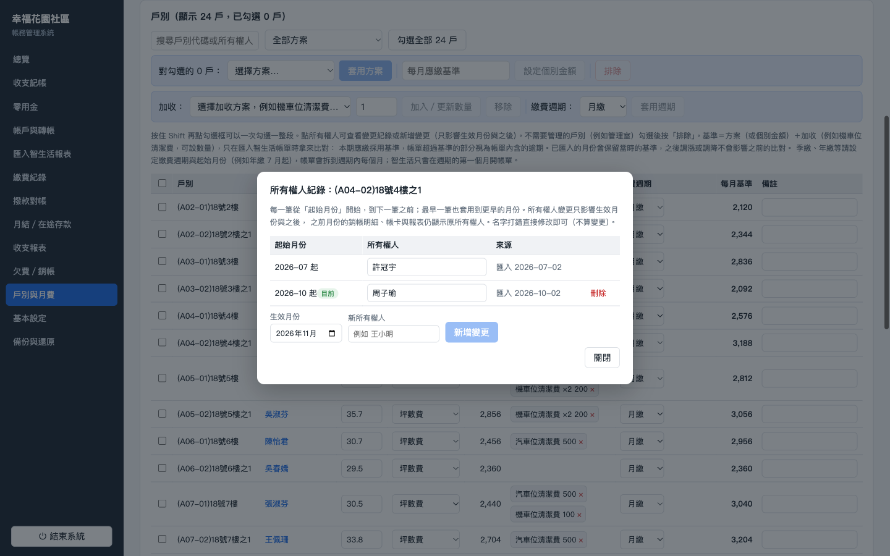

### 5. 每月應繳一覽

選月份就能看到每戶的本期基準、智生活帳單、帳單內含逾期與本月應繳。這裡只能查看，應繳一律來自智生活報表。

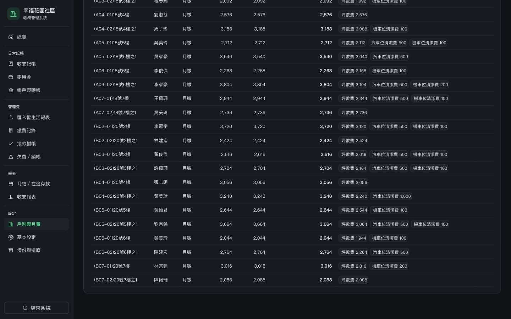

### 6. 逐月銷帳與欠費總表

匯入「管理費入帳報表」後，每筆繳款自動銷帳：先照期別，再從最早未繳的月份往後銷。金額和帳單不同時，會跳出視窗讓你決定要銷哪個月。
月份總表一眼看出誰欠了哪幾期，換過所有權人的戶別會標示「曾變更」。

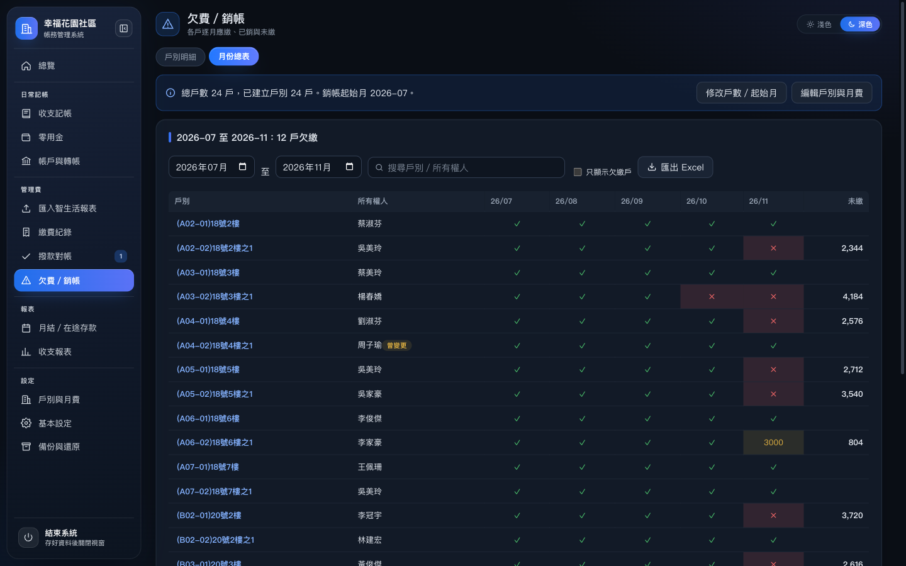

### 7. 戶別帳卡

每戶的逐月應繳、已銷、未繳與每筆繳款的銷帳情形，可以列印給住戶，也可以手動調整銷帳。

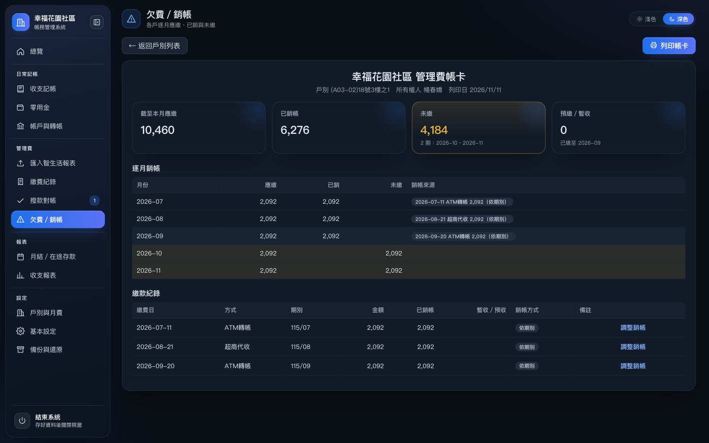

### 8. 撥款對帳與在途存款

入帳日一律採用智生活報表上的日期，依入帳日與繳費方式分組，拿存摺逐筆核對。月底前還沒撥入銀行的款項，自動列為在途存款。

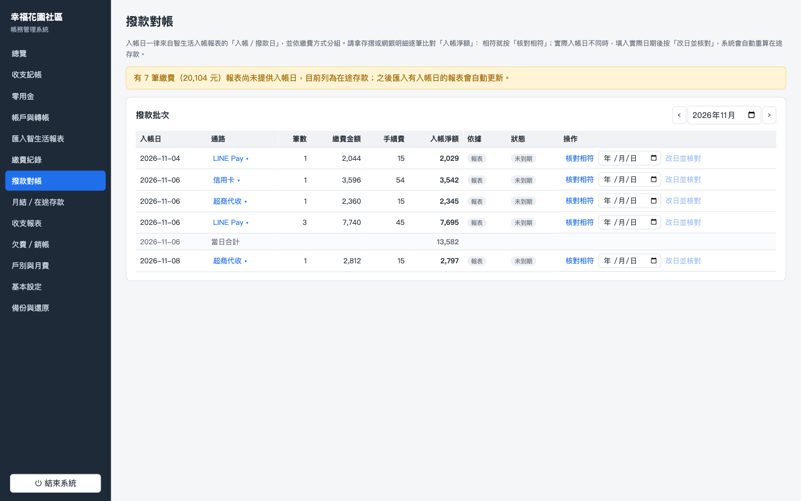

### 9. 月結與收支報表

月結依序列出收支明細表、管理費入帳及在途存款、結存表，確認後結帳鎖定。
收支報表可切換月報與年報。月報可列印彩色「財務收支總表」、管理費銷帳明細與預收款項銷帳紀錄（逐戶預收款增減與沖銷明細），年報可列印 1～12 月與全年報表，都附簽章欄。

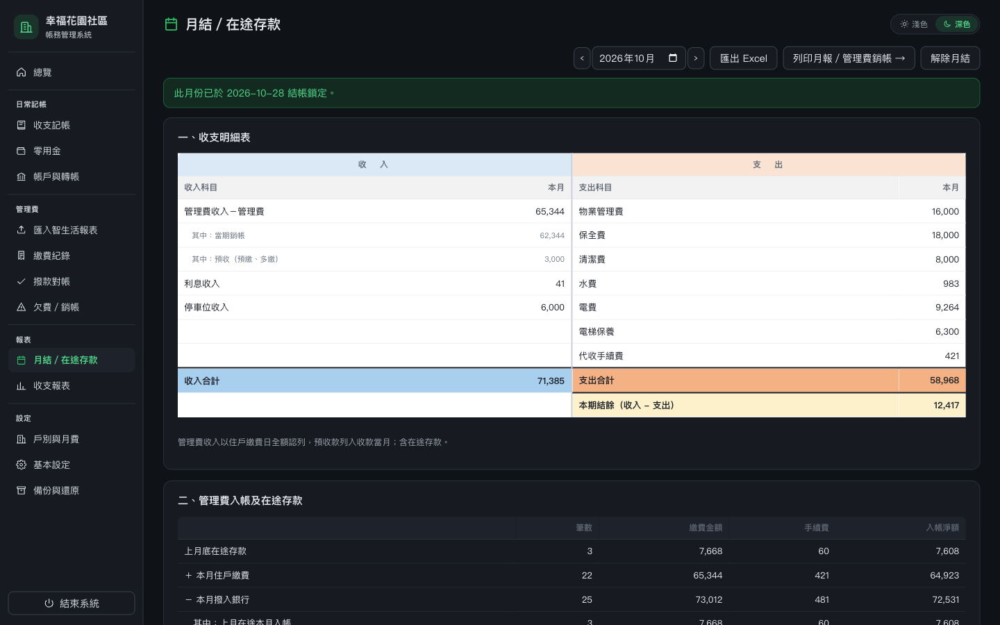

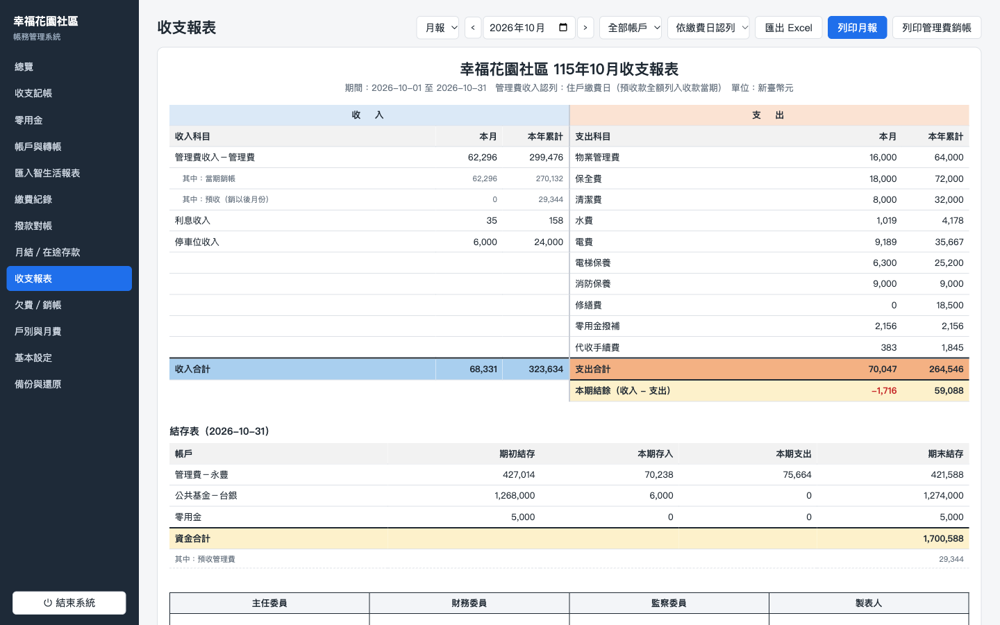

### 10. 零用金

零用金逐筆記錄、自動計算餘額，每月一鍵產生「零用金撥補」。收支報表只會出現撥補這一筆。

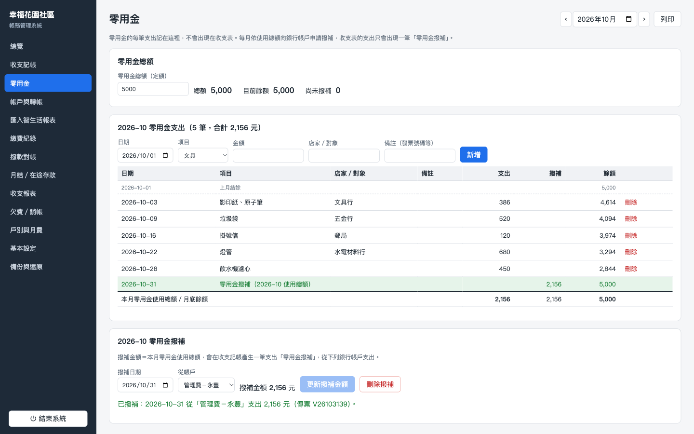

## 開始使用

1. 解壓縮 `社區帳務管理-v0.6.0.zip`，放到例如 `D:\社區帳務管理`（不要在壓縮檔裡直接執行）。
2. 雙擊 `社區帳務管理.exe`。系統在背景執行並自動開啟瀏覽器，第一次開啟會播放使用說明動畫。
   - Windows 若顯示「Windows 已保護您的電腦」，請按「其他資訊」→「仍要執行」。
   - 防毒軟體若封鎖，請把整個資料夾加入例外清單。
3. 依畫面上的步驟建立資料：
   1. 從智生活後台「繳費單列表」匯出管理費匯入範本。
   2. 「匯入智生活報表 → 每月應繳報表」匯入，建立戶別與所有權人（不需要的戶別勾選排除）。
   3. 「戶別與月費 → 基準與費率」建立費率方案並套用到每戶。
   4. 再匯入同一份範本，建立每月應繳。
   5. 「基本設定 → 戶數與銷帳」確認總戶數與帳務起始月。
4. 要結束時，按網頁左下角的「結束系統」。

### 每月作業

| 步驟 | 頁面 | 做什麼 |
|---|---|---|
| 1 | 匯入智生活報表 → 每月應繳報表 | 匯入當月管理費匯入範本，確認和基準、所有權人不同的戶別 |
| 2 | 匯入智生活報表 → 入帳報表 | 匯入管理費入帳報表，自動銷帳、計算在途存款 |
| 3 | 撥款對帳 | 拿存摺核對撥款 |
| 4 | 收支記帳、零用金 | 登錄其他收入與支出、產生零用金撥補 |
| 5 | 月結／在途存款 | 檢查後匯出 Excel、結帳鎖定 |
| 6 | 收支報表 | 列印月報、管理費銷帳、預收款項銷帳紀錄給委員簽名 |

完整操作說明請看 [docs/使用說明.txt](docs/使用說明.txt)。打包時會同時產生圖文版 `使用說明.html` 放進壓縮檔。

## 資料與安全

- 所有資料存在 exe 旁邊的 `data/ledger.json`，每天第一次存檔前自動備份到 `data/backups/`（最多 60 份）。
- 「備份與還原」可以下載完整備份，也能還原任一天的備份檔。
- 重複匯入同一份報表不會重複計算；已月結的月份會鎖定，不能再匯入或修改。
- 每一次修改都記在操作紀錄裡。

## 開發

前端是 Vite + React + TypeScript 的單一 HTML 檔，由 Go 啟動程式（只用標準函式庫）內嵌並提供服務，資料透過 `/api/data` 存到 `data/ledger.json`。Windows 版以背景程式執行，沒有主控台視窗。

```bash
npm install
npm run dev             # 開發伺服器 http://localhost:5180
npm test                # vitest 單元測試
npm run typecheck
npm run start:mac       # 編譯 Mac 版啟動程式並執行，資料放在 dev-app/data
npm run build           # 打包 Windows 版到 release/社區帳務管理-v<版本>.zip
npm run test:launcher   # 啟動程式的 Go 測試（沒有安裝 Go 時用 Docker）
```

| 功能 | 程式位置 |
|---|---|
| 報表解析（標題列偵測、欄位別名、民國年、Big5 CSV） | [src/lib/parser.ts](src/lib/parser.ts)、[src/lib/dates.ts](src/lib/dates.ts) |
| 每月應繳匯入、基準比對、帳單內含逾期 | [src/lib/bills.ts](src/lib/bills.ts)、[src/lib/dues.ts](src/lib/dues.ts)、[src/components/BillImport.tsx](src/components/BillImport.tsx) |
| 費率方案、加收、繳費週期 | [src/lib/fees.ts](src/lib/fees.ts) |
| 所有權人紀錄、匯入時排除戶別 | [src/lib/owners.ts](src/lib/owners.ts) |
| 逐月銷帳、欠費、帳卡 | [src/lib/allocation.ts](src/lib/allocation.ts) |
| 在途存款、月報、帳戶餘額 | [src/lib/ledger.ts](src/lib/ledger.ts) |
| 收支報表 | [src/lib/statement.ts](src/lib/statement.ts) |
| Excel 匯出 | [src/lib/xlsxio.ts](src/lib/xlsxio.ts) |
| 資料儲存與備份 | [launcher/main.go](launcher/main.go)、[src/lib/storage.ts](src/lib/storage.ts) |
| 打包與使用說明 | [scripts/package-release.mjs](scripts/package-release.mjs)、[scripts/guide-html.mjs](scripts/guide-html.mjs) |
